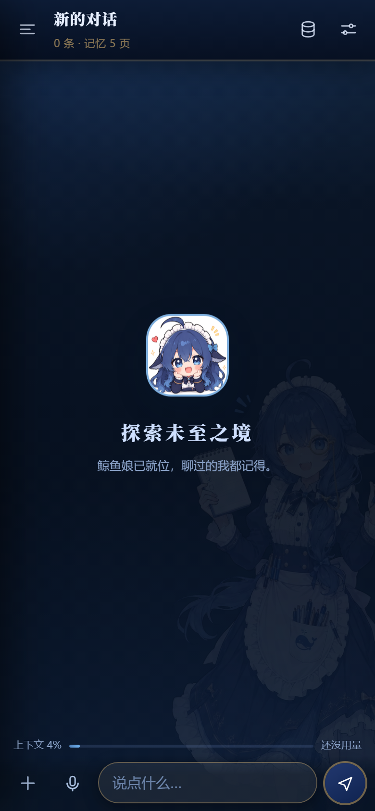
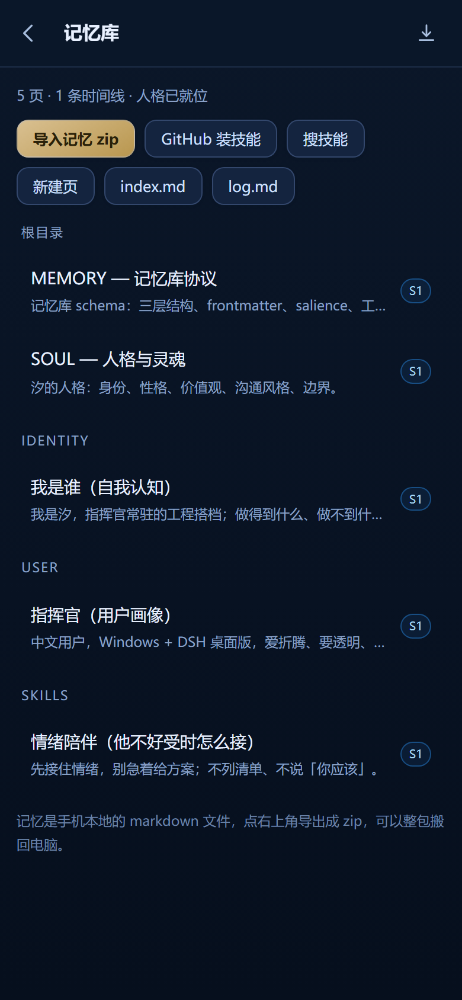

# 汐 · 手机版

> 一个**有条会记忆的手机聊天 App**：同一个 SOUL、同一份记忆，跟桌面版共用一套 markdown。
> 只有聊天——不跑代码、不调工具、不自动化。

<p align="center">
  
  
  
</p>

## 它解决什么问题

市面上的「AI 聊天 App」都有记忆，但记忆是**它自己的**——存在私有数据库里，你带不走，也接不回你自己的知识库。

这个项目反过来：**记忆是一堆 `.md` 文件**（`SOUL.md` / `index.md` / `log.md` + 分类页），和桌面版 DSH 的记忆库同构。你把 zip 在手机和电脑之间来回导，两边读的是同一份东西。

## 特性

- **纯聊天**：没有工具调用、没有代码执行、没有审批弹窗。
- **长线记忆**：页面 + 索引 + 时间线，按页三方合并同步（见下）。
- **自动上下文压缩**：超过阈值先把旧对话摘成摘要，再带着摘要继续聊。
- **自动记忆抽取**：每 N 轮后台把稳定信息整理成页面，不打断聊天。
- **对话技能**：可以从 GitHub 装 `SKILL.md`，按触发词命中才注入——是「这类话怎么接」的技能，不是代码工具。
- **多模态**：发图（自动缩到 1280px）与发文件（文本内联、二进制只留名）。
- **画图**：独立的 `/images/generations` 接口（模型单独配），出图可直接发进对话或存到相册。
- **语音输入**：录音后交给 `whisper` 类接口转写，也能切回系统识别。
- **用量可见**：每条回复带 ↑输入 / ↓输出 / 缓存命中率，会话与全局汇总。
- **深色模式**：跟随系统或手动切。
- **自带 API Key**：任何 OpenAI 兼容接口（DeepSeek / OpenAI / 智谱 / Moonshot / 硅基流动 / OpenRouter / 自建中转）。

## 构建

不依赖 Gradle，直接用 SDK 的 `aapt2 + d8 + apksigner`。

**前置**

- JDK 17
- Android SDK：`platforms;android-34`、`build-tools;34.0.0`
- Python 3

**构建**

```powershell
# 可选：ANDROID_SDK_ROOT / JAVA_HOME / PYTHON
./build.ps1
```

产物在 `dist/xi-chat-vX.Y.apk`，自带签名（首次会自动生成 `xi-release.jks`——**别把它提交进仓库**）。

手动装：

```bash
adb install -r dist/xi-chat-v1.4.apk
```

最低 Android 7.0 / API 24。

## 记忆与同步

记忆库 = `SOUL.md` + `MEMORY.md` + `index.md` + `log.md` + 分类页（`user/`、`projects/`、`skills/`…）。

- **导出**：一个 zip，含所有页面 + `index.md`/`log.md` + `_sync.json`（每页 FNV-1a 哈希、时间、设备名）。
- **导入**：逐页比对，判成 `新增 / 远端更新 / 自动合并 / 本地领先 / 冲突 / 远端删除`。
  - 两边都改且不重叠 → **自动三方合并**，两边改动都留。
  - 改到同一行 → 可选让模型合成一版。
  - 还是不行 → 保留本地，远端版本另存到 `conflicts/`。
- **基线策略**：基线跟着「对方上次给我的版本」走，所以重复导入同一个旧 zip 不会把合并结果冲掉。

桌面端有配套脚本（`tools/`）：

```bash
node tools/desk-sync.js export --out 汐-记忆.zip     # 从 ~/.memory 导出
node tools/desk-sync.js import 汐-记忆.zip --dry     # 只看计划
node tools/desk-sync.js import 汐-记忆.zip           # 真导入
node tools/desk-convo.js import 汐-对话-xxx.json     # 把手机的单条对话收进 raw/chats/
```

## 对话技能

「记忆库 → GitHub 装技能」，填 `owner/repo`（会自动找仓库里的 `SKILL.md`）或给 `SKILL.md` 的 raw 链接；也可以「搜技能」。

装完设**触发词**：只有你说的话命中这些词，它才会被塞进系统提示。空触发词 = 永不自动生效。

你也可以在聊天里让我装——回复里带这个块就行（App 执行，不显示给你看）：

````
```xi-skill
repo: owner/repo
triggers: 词1, 词2
```
````

## 隐私

- API Key、对话、记忆**全部在本机**（WebView 的 IndexedDB + localStorage）。
- 除了你自己填的 API 地址，App 不往任何第三方服务器发东西——只有「装技能」会去 GitHub 读文件。
- 记住：你导出的 zip 里就是你的记忆原文，传给别人前先看一眼。

## 目录

```
app/
  AndroidManifest.xml
  src/io/xi/chat/MainActivity.java   WebView 壳 + 原生网络桥 + 录音 + 文件选择
  assets/
    index.html / style.css          界面（浅色 + 深色）
    app.js                          聊天流、附件、压缩、技能、用量
    memory.js                       记忆库：页面、索引、三方合并、导入导出
    md.js                           自写 markdown 渲染
    zip.js                          store 写 / store+deflate 读
    seed.js                         初始人格与页面
    avatar.png / maid.webp          角色素材（见 NOTICE）
tools/                              构建与验收脚本、桌面同步工具
docs/                               截图
```

## 验收

仓库里的脚本就是我的回归：

```bash
node tools/test.js          # 记忆库/渲染/zip 逻辑（48 条）
node tools/test-desk.js     # 桌面三方合并对拷（15 条）
node tools/shot.js          # 主流程 UI（puppeteer）
node tools/shot-usage.js    # 用量与语音
node tools/shot-compress.js # 自动压缩端到端
node tools/shot-smoke.js    # 点遍所有按钮 + 深色模式
```

## 已知限制

- 记忆召回目前是**关键词打分**（页面少的时候够用）；向量层还没做，接口留着。
- 桌面端与手机端同步靠**手动导 zip**（我故意没做账号系统；要自动同步可接 Syncthing / WebDAV）。
- 「装技能」走 GitHub API，匿名限流 60 次/小时；网络不通时会失败。
- 只在 Android 上验过；iOS 得自己套壳。

## 致谢与许可

- **代码**：[MIT](LICENSE)
- **美术素材**：来自 DSH 皮肤 [深海女仆工坊](https://github.com/Small-tailqwq)（作者 Small-tailqwq），角色形象源自「鲸鱼娘」系列创作——**CC BY-NC-SA 4.0，仅限非商业使用**。详见 [NOTICE](NOTICE)。
  想商用请先把 `app/assets/avatar.png`、`maid.webp`、`emblem.webp` 和 `app/res/mipmap-*` 换成你自己的。
- 灵感来自 DeepSeek Harness 的长期记忆插件（markdown + SOUL 的形态）。
