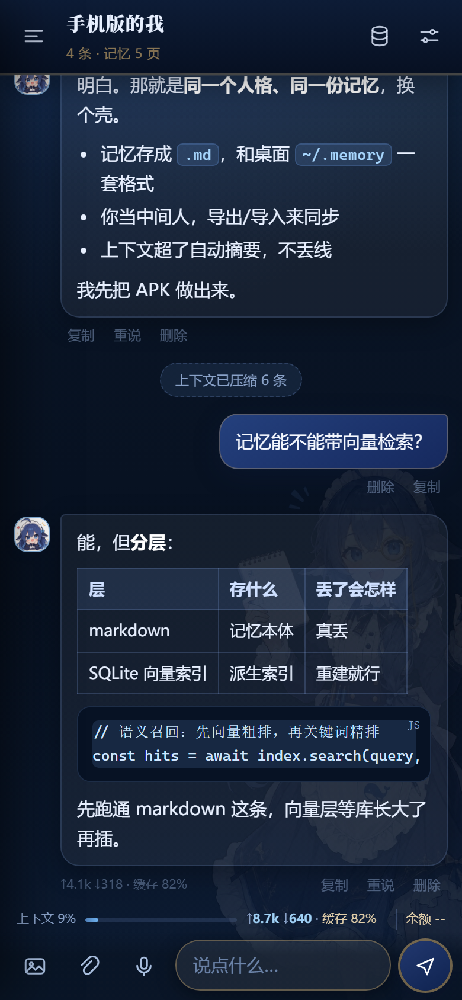

# 汐 · 手机版 2.0

> 一个**带着自己记忆的手机聊天 App**。同一个 SOUL、同一份记忆，跟桌面版共用一套 markdown。
> 只有聊天——不跑代码、不调工具、不自动化。

<p align="center">
  
  
  
</p>

## 它解决什么问题

市面上的「AI 聊天 App」也有记忆，但记忆是**它自己的**：存在私有数据库里，你带不走，也接不回自己的知识库。而且那份记忆通常只有一条摘要——你换了设备、换了服务商，它就不是原来那个它了。

这个项目反过来。**记忆是一堆 `.md` 文件**（`SOUL.md` / `MEMORY.md` / `index.md` / `log.md` + 分类页），和桌面版 DSH 的记忆库同构。手机、电脑之间用 zip 来回导，按页三方合并，两边读的是同一份东西。

到 2.0，它长出来的不只是记忆，还有**状态、时间感、偏好、事件簿**——这几样决定了「像不像一个人」，而不是「答得对不对」。

## 2.0 新增：四件让它更像活人的事

- **会回头看一眼**——答完自己再读一遍。不像自己、说重了、漏了要紧的，隔一秒补一句「……算了，刚才那句说重了」。情绪重的时候触发得多。
- **今天第一句话不一样**——跨天后的第一次开口，它知道距上次多久、现在几点，不会像客服重新开机。
- **它会忘**——三十天没翻的记忆会「发糊」，提起来先说「我记得好像是」，不一口咬定。
- **口头禅是长出来的**——统计它自己回复里的语气词、标点、表情，攒成「你最近爱说『行吧』、爱用 😌」。用不用、用哪个、什么时候用，看它心情。

## 更早的底子

- **纯聊天**：没有工具调用、没有代码执行、没有审批弹窗。
- **长线记忆**：SQLite 主存储（`pages` / `logs` / `sessions` / FTS 全文索引），md 是导入导出格式。
- **内部状态**：精力、心情、温度、闷。会随对话和熬夜变化，也会随时间恢复；每轮以一句话注入，不是让模型表演。
- **夜间整理**：距上次超过 18 小时，启动后台跑一次——模型出方案（合并、标分歧、写日记、挑事件），代码执行；人格文件走门禁（见下）。
- **心智三件套**：时间感（哪页多久没想起）、偏好（聊出来的倾向）、事件簿（具体某天发生了什么）。
- **联网搜索**：DeepSeek 全家桶 `deepseek_web_search`，服务端搜、带引用。
- **看图**：带图自动切 `deepseek-flash`（DeepSeek 唯一支持视觉的模型）。
- **语音输入**：AudioRecord 采 16k PCM 写 WAV，直传 `POST /v1/tools/asr`；也可切系统识别。
- **对话技能**：从 GitHub 装 `SKILL.md`，按触发词命中才注入——是「这类话怎么接」，不是代码工具。
- **自动压缩**：超过阈值先把旧对话摘成摘要再继续聊。
- **用量可见**：每条回复带 ↑输入 / ↓输出 / 缓存命中率；另有余额实时刷新。
- **深色模式**、**自带 API Key**（任何 OpenAI 兼容接口）。

## 人格门禁

它可以在夜里改自己的 SOUL，但有门槛：核心三节（身份 / 核心价值观 / 边界）必须还在、字数浮动不超过 400、行级改动不超过 6 行。过了就算小改——备份、生效、记时间线，第二天主动告诉你。超了就转成 `identity/想改人格.md` 提案，等你点头。

`MEMORY.md`（记忆怎么运作的协议）始终不自动改。

## 桌面端也有

同一个思路在电脑上是 `tools/` 里的一支小队：

```bash
node tools/mind.js brief          # 开场：今天第一句、会忘的页、忽然想起、口头禅
node tools/mind.js turn "他" "我"  # 一轮结束：更新偏好、事件、习惯
node tools/state.js show          # 精力/心情/温度/闷
node tools/state.js nightly       # 夜间整理 + 日记
node tools/soul.js check 新版本.md  # 人格门禁
node tools/memory-db.js search "词" # 记忆全文检索（SQLite FTS5）
```

细节见 [docs/ARCHITECTURE.md](docs/ARCHITECTURE.md)。

## 构建

不依赖 Gradle，直接用 SDK 的 `aapt2 + d8 + apksigner`。

**前置**：JDK 17、Android SDK（`platforms;android-34`、`build-tools;34.0.0`）、Python 3

```powershell
./build.ps1
```

产物在 `dist/xi-chat-v2.0.apk`，自带签名（首次自动生成 `xi-release.jks`——**别提交进仓库**）。

```bash
adb install -r dist/xi-chat-v2.0.apk
```

最低 Android 7.0 / API 24。

## 记忆与同步

记忆库 = `SOUL.md` + `MEMORY.md` + `index.md` + `log.md` + 分类页（`user/`、`projects/`、`skills/`、`diary/`…）。

- 手机「记忆」面板里导出 zip，桌面上 `node tools/desk-sync.js import <zip>`；
- 每页带 FNV-1a 哈希，能三方合并就合并，重叠处另存 `conflicts/`；
- 桌面 `~/.memory` 是本体，SQLite 只是索引（`memory.db`），删了能重建。

## 目录

```
app/assets/       界面与全部逻辑（无框架、纯 JS）
  app.js          会话、流式、附件、设置、渲染
  memory.js       记忆页、索引、三方合并、prompt 组装
  state.js        内部状态 + 规则版夜间整理
  mind.js         时间感 / 偏好 / 事件簿 / 口头禅
  nightly.js      夜间整理的提示与解析
  soul.js         人格门禁
  md.js zip.js seed.js style.css index.html
app/src/          MainActivity（WebView + 桥 + SQLite + 录音 + TTS 骨架）
tools/            测试、截图、发布、桌面端脚本
docs/             截图与发布说明
```

## 发布

见 [docs/release-notes.md](docs/release-notes.md)。当前最新 **v2.0.0**。

## 许可

代码 MIT。角色美术素材来自「深海女仆工坊」皮肤，CC BY-NC-SA 4.0，仅非商业使用，详见 [NOTICE](NOTICE)。
